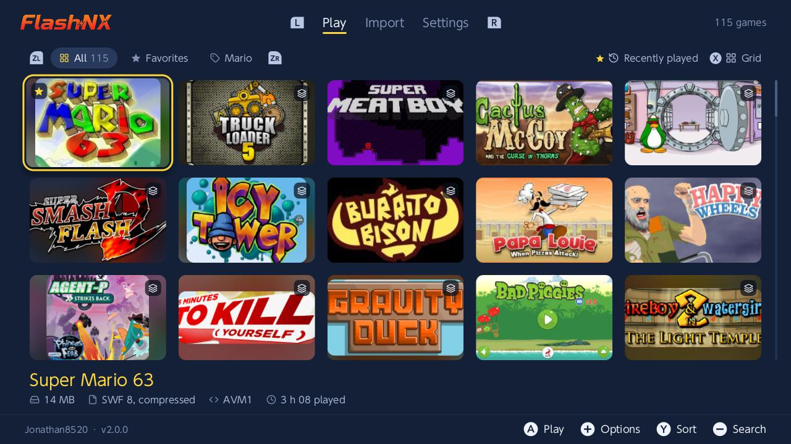
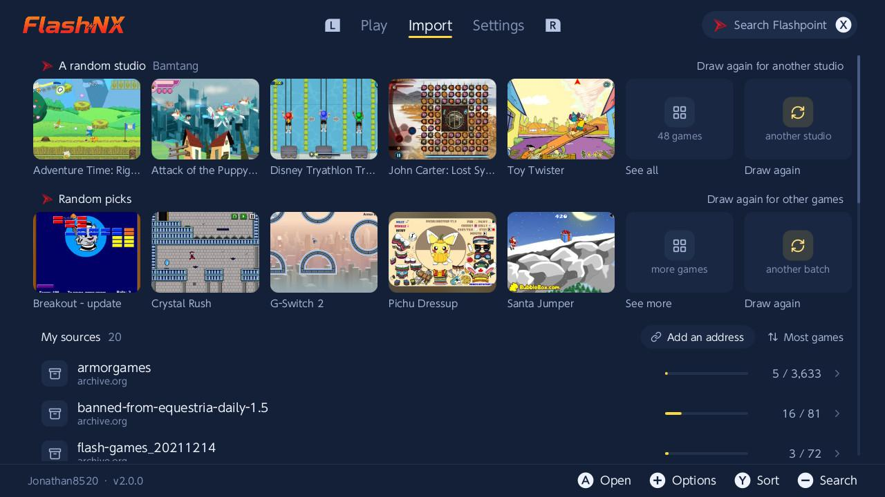
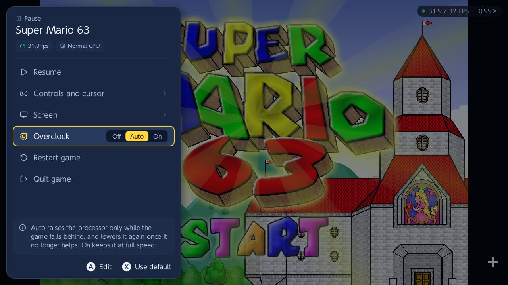
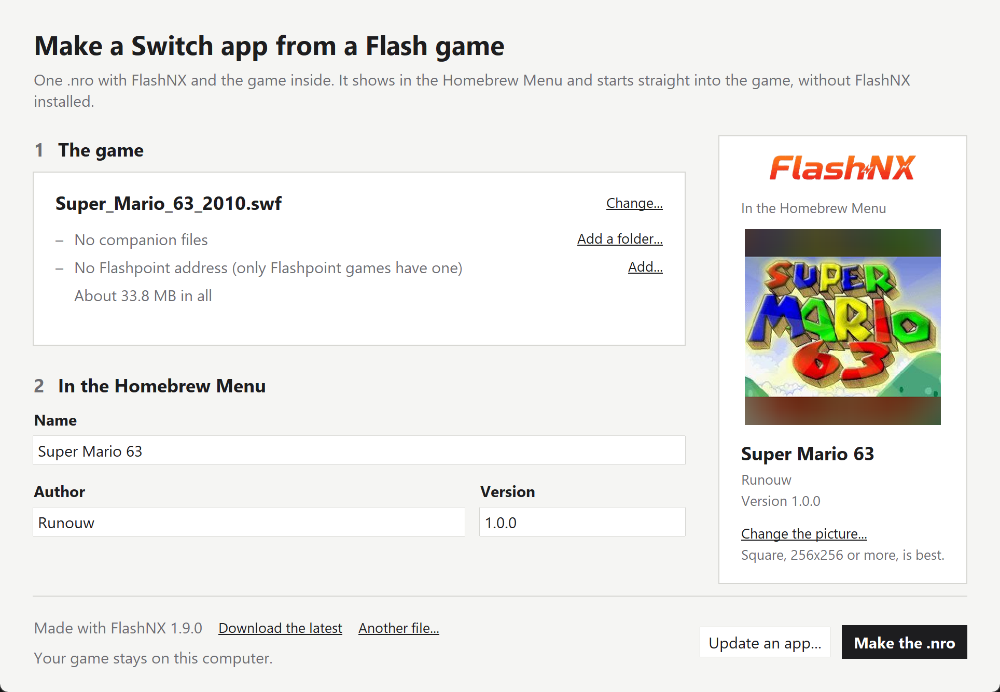

  

  <strong>Play Flash games on your Nintendo Switch.</strong> 
  FlashNX runs <code>.swf</code> games (ActionScript 1, 2 and much of 3) and downloads them for you from the Flashpoint Archive. 
  Powered by <a href="https://github.com/ruffle-rs/ruffle">Ruffle</a>.

  
  
  
  

  

| Getting games | In game |
|:---:|:---:|
|  |  |

## Install

1. You need a Switch running **Atmosphère**.
2. Install **FlashNX** from the **[Homebrew App Store](https://hb-app.store/switch/FlashNX)**, or copy **`FlashNX.nro`** from the [latest release](https://github.com/Jonathan8520/FlashNX/releases/latest) to **`sdmc:/switch/FlashNX/`**.
3. **Hold R while opening any game from the HOME Menu**, then pick FlashNX in the Homebrew Menu. This gives it the console's full memory.

Opened from the Album, FlashNX gets too little memory for Flash games. It says so and offers to put its icon on the HOME Menu, which always starts it with the full memory (an icon on the HOME Menu needs signature patches, like any homebrew).

## Get games

- **From the console**: the **Import** tab shows games from the [Flashpoint Archive](https://flashpointarchive.org/), a random studio and random games, without adult, crude or gory ones. **A** downloads a game with its cover and the files it needs, **+** shows its details first, **X** searches by name.
- **From a web address**: a direct `.swf` link, an archive.org item or a Wayback Machine snapshot, in the same tab.
- **From a computer**: copy `.swf` files to **`sdmc:/flashnx/`**. A `<game>.png` or `.jpg` next to one becomes its cover.

## Play

**In the library**, the bottom of the screen shows what the buttons do. Also: **L / R** change tab, **ZL / ZR** change folder, **X** changes the layout (grid, list, strip or shelf).

**In a game**, **−** opens the pause menu. Every game starts with a ready-made layout: the left stick for the arrow keys, A for Space, the right stick or touch for the mouse cursor, ZR to click. The pause menu changes any of it, for that game only:

- **Controls and cursor**: any button to any key or mouse click. Holding ZL, ZR, L or R gives the buttons a second key.
- **Up to four players**, each with their own controller and keys. A single Joy-Con held sideways counts as a whole controller.
- **Shared profiles**: download the controls other players made for a game, or share yours.
- **Screen** (display, rotation, zoom, filters), **Overclock**, **Restart** and **Quit**.

## Features

- A **HOME Menu icon** for any game, with its name and cover, that starts straight into it.
- **Folders**: a game can be in several, and its file stays where it is.
- **Saves** kept on the SD card, and **play time** for each game.
- **Overclock AUTO** raises the CPU only while a game falls behind, and only if it helps.
- **Gyroscope cursor**: aim like a Wii remote, or tilt the console like a tray with a marble on it.
- **9 languages**, picked from the console's language.
- **Report a bug or send a suggestion** from Settings, with no account.

## Turn a game into its own Switch app

  

**`make_standalone.py`** puts FlashNX and one game into a single `.nro`: an app with its own name and picture in the Homebrew Menu, which starts straight into the game. Nothing else to install on the Switch.

1. Install [Python](https://www.python.org/downloads/) on your computer.
2. Download **`make_standalone.py`** from the [latest release](https://github.com/Jonathan8520/FlashNX/releases/latest) and double-click it.
3. Drop the game's `.swf` on the window: the files FlashNX downloaded with it come along. Check the name and the picture, then press **Make the .nro**.
4. Copy the app to `sdmc:/switch/<Its_Name>/` on the SD card.

**Update an app...** moves an app made earlier to a newer FlashNX, keeping its game. Command line and details: [DEVELOPMENT.md](DEVELOPMENT.md#without-building-anything-scriptsmake_standalonepy).

## Known limitations

- **Not every game works**: compatibility, especially for ActionScript 3, is [Ruffle's](https://ruffle.rs/compatibility). Report a game that does not work from **Settings › Help and feedback › Report a bug**.
- **Heavy games can slow down.** Overclock AUTO helps where it can.
- **No savestates.** The games' own saves work.
- **Audio** can crackle a little in very busy scenes.

## Credits & licenses

FlashNX is only a **Switch integration layer**. All credit for the Flash emulation goes to **Ruffle**.

- **[Ruffle](https://github.com/ruffle-rs/ruffle)** *(Apache-2.0 / MIT)*: the Flash engine, SWF parsing and the ActionScript virtual machines. FlashNX embeds `ruffle_core`, `ruffle_render`, `ruffle_video_software`, `naga-agal` and `swf`.
- **[devkitPro](https://devkitpro.org/) / libnx** *(ISC)*: Switch toolchain and Horizon API.
- **[switch-mesa](https://github.com/devkitPro/pacman-packages)** *(MIT)*: OpenGL/GLES via Nouveau, the graphics backend, with a modified copy of devkitPro's **libdrm_nouveau** *(MIT)* built in (`cpp/third_party/libdrm_nouveau`).
- **Networking**: [libcurl](https://curl.se/) · [Mbed TLS](https://github.com/Mbed-TLS/mbedtls) · [zlib](https://zlib.net/) · [Mozilla](https://curl.se/docs/caextract.html) CA bundle.
- **Rust crates**: [jpeg-decoder](https://github.com/image-rs/jpeg-decoder) (a fork patched for newlib, `third_party/jpeg-decoder-switchfork`) · `jpeg-encoder` · `png` · `image-webp` · `ttf-parser` · `ab_glyph_rasterizer` · `serde` · `serde_json` · `flate2` · `dlmalloc` · `url` · `encoding_rs`, plus Ruffle's own dependencies.
- **[Lucide](https://lucide.dev/)** *(ISC, with icons from Feather under MIT)*: the interface icons, as a font subset built by `scripts/make_icon_font.py`; both notices are in `rust/src/backend/render/kit/icons-LICENSE.txt`.
- **[Flashpoint Archive](https://flashpointarchive.org/)**: the Flash preservation project. FlashNX uses its public APIs so you can find cover art and download the games you choose. Preserved games remain the property of their original creators, and FlashNX only fetches what you explicitly request. The Flashpoint logo in the Import tab is the Flashpoint Archive's, under [CC BY 4.0](https://flashpointarchive.org/branding) (`assets/flashpoint.png`: its colorized version, cropped and resized).
- **[Internet Archive](https://archive.org/)**: the archive.org items and Wayback Machine snapshots the Import tab can take a game from.

**License**: the FlashNX integration code is under the **MIT** license (see [`LICENSE`](LICENSE)). Ruffle and the other dependencies keep their own.

---

**Architecture, build and technical notes**: [DEVELOPMENT.md](DEVELOPMENT.md) · **Changelog**: [CHANGELOG.md](CHANGELOG.md)
